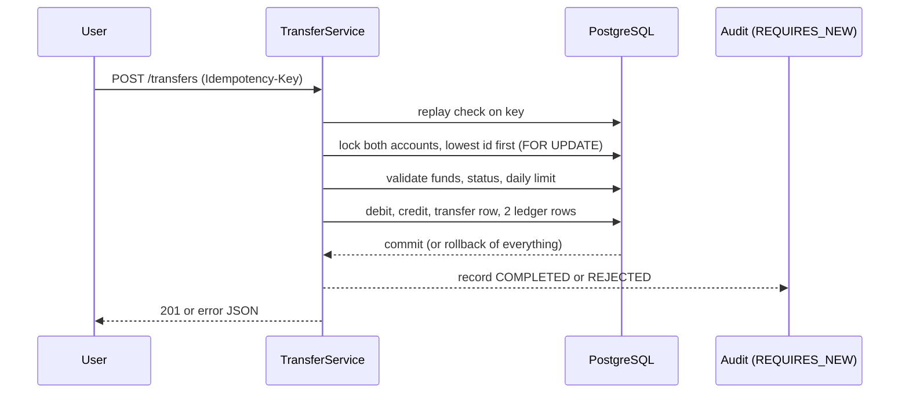

# Architecture

## Request path

```mermaid
flowchart LR
    C[Client] --> F[RequestLoggingFilter<br/>X-Request-Id]
    F --> S[Spring Security<br/>JWT, roles]
    S --> K[Controllers<br/>validation]
    K --> A[AuditAspect / MetricsAspect]
    A --> V[Services<br/>@Transactional]
    V --> R[Repositories]
    R --> D[(PostgreSQL 16<br/>Flyway V1-V5)]
```

## Transfer



## Controls

| Risk | Control | Where |
|---|---|---|
| Lost update, double spend | Row locks | `AccountRepository.findByIdForUpdate` |
| Deadlock | Global lock order | `TransferService` |
| Half-completed transfer | Single transaction | `TransferService` |
| Duplicate submission | Idempotency key | `V3`, `TransferService` |
| Negative balance | App check plus DB `CHECK` | `Account.debit`, `V2` |
| Silent data drift | Ledger reconciliation | `ReconciliationService` |
| Repudiation | Append-only audit log | `AuditAspect`, `V5` |
| Password guessing | Throttle plus BCrypt | `LoginAttemptService` |
| Account enumeration | 404 for foreign accounts, same login error | services |
| Hard to debug in production | Request id, metrics | filter, `TransferMetricsAspect` |
| Layering erosion | ArchUnit rules | `ArchitectureTest` |
