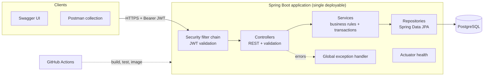
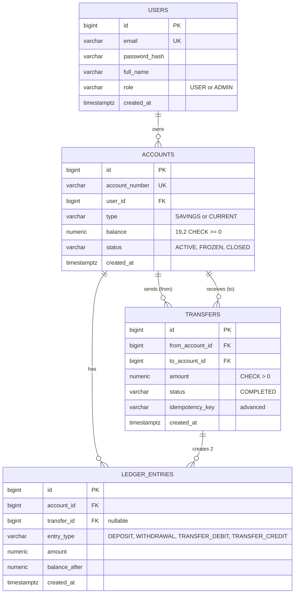
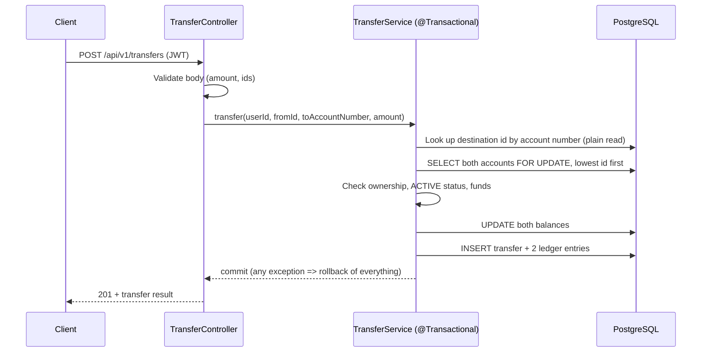

# Design

Technical design of BankSim, a simulated online banking backend. Requirement IDs (`BANK-FR-xx`, `BANK-NFR-xx`) are referenced from the tests and from [`TRACEABILITY.md`](TRACEABILITY.md). Newer decisions are recorded in [`adr/`](adr), and the layered view with diagrams is in [`ARCHITECTURE.md`](ARCHITECTURE.md).

## 1. Problem and scope

Customers need to hold money in accounts and move it safely. The main risks are lost updates (two requests overwrite each other), half-completed transfers, unauthorised access to other customers' accounts, and balances that silently drift from the underlying records. BankSim addresses these with database transactions, row-level locking, ownership checks, an immutable audit trail and an independent reconciliation job. All data is fictional, the currency is INR, and no real payment systems are involved.

**Roles.** Customer (`USER`): registers, opens accounts, deposits, withdraws, transfers, views history. Administrator (`ADMIN`): lists and freezes accounts, reads the audit trail, runs reconciliation.

**Out of scope.** Real payments, KYC, notifications, microservices, message brokers, mobile client.

## 2. Key technology decisions

| Decision | Rationale | Trade-off |
|---|---|---|
| Java 21, Spring Boot 3.5, Maven, PostgreSQL 16 | Long-term-support Java; widely used Boot 3 line | Boot 3.5 open-source support has ended; migration to Boot 4 is a planned follow-up |
| JWT with Spring Security (OAuth2 Resource Server) | Stateless, standard, no hand-written crypto | Short-lived tokens only; no refresh tokens |
| Pessimistic row locks, ascending account id | No lost updates; removes the deadlock cycle ([ADR 0001](adr/0001-pessimistic-locking.md)) | Hot accounts are serialised |
| Flyway migrations | Versioned, reproducible schema | One more tool |
| Testcontainers with real PostgreSQL | Locking and constraints differ in H2 | Needs Docker to run tests |
| Swagger UI and Postman as the client | The value is in the backend | No custom UI |

## 3. Functional requirements

| ID | Requirement | Acceptance criteria |
|---|---|---|
| BANK-FR-01 | Register | Given a new email and a valid password, when I register, then I get 201 and the password is stored only as a BCrypt hash. A duplicate email returns 409. |
| BANK-FR-02 | Login | Given correct credentials, I get a JWT that expires in 15 minutes. Wrong credentials return 401 with no hint about which part was wrong. |
| BANK-FR-03 | Open account | A logged-in user can open SAVINGS or CURRENT accounts. Each gets a unique 12-digit fictional number and starts with balance 0.00. |
| BANK-FR-04 | List/view my accounts | I see only my own accounts. Asking for someone else's account returns 404 (not 403, so existence is not leaked). |
| BANK-FR-05 | Deposit | Amount must be at least 0.01 with at most 2 decimals. Balance increases by exactly that amount and a ledger row is written. |
| BANK-FR-06 | Withdraw | Fails with 422 `INSUFFICIENT_FUNDS` if balance would go below zero. Balance never becomes negative. |
| BANK-FR-07 | Transfer | Money moves between two ACTIVE accounts in **one** database transaction. If any step fails, neither balance changes. The destination is identified by its 12-digit account number, never by internal id. Cannot transfer to the same account. I must own the source account. An unknown destination number returns 404. |
| BANK-FR-08 | Transaction history | Paginated, newest first, filterable by type and date range. Only for my own accounts. |
| BANK-FR-09 | Freeze/unfreeze (ADMIN) | A FROZEN account rejects deposits, withdrawals and transfers with 409 `ACCOUNT_FROZEN`. Only ADMIN can change status; a USER gets 403. |
| BANK-FR-10 | Consistent errors | Every error uses one JSON shape (section 8) and never shows a stack trace. |
| BANK-FR-11  | Idempotent transfer | Sending the same `Idempotency-Key` twice creates one transfer and returns the same result. |
| BANK-FR-12 | Daily limit | Total outgoing transfers per account per day cannot exceed a configured limit. |
| BANK-FR-13 | Audit trail | Registration, login, transfer and admin status changes are recorded with outcome, actor and request id, including rejected attempts. Rows cannot be updated or deleted (database trigger). Admin read endpoint. |
| BANK-FR-14 | Reconciliation | Every balance is recomputed from the ledger nightly and on demand; any difference is reported and exposed as a metric. |

## 4. Non-functional requirements

| ID | Requirement | Verified by |
|---|---|---|
| BANK-NFR-01 | **Correctness:** sum of ledger entries for an account always equals its balance | `LedgerIntegrityIT` |
| BANK-NFR-02 | **Concurrency safety:** parallel transfers never lose money or deadlock | `ConcurrentTransferIT` |
| BANK-NFR-03 | **Security:** no secrets in Git; passwords hashed; every endpoint except register/login/health needs a valid JWT | Secret scanning, `ApiFlowIT` |
| BANK-NFR-04 | **Reproducibility:** a stranger can run it with `docker compose up` | Clean-clone `docker compose up` |
| BANK-NFR-05 | **Observability:** `/actuator/health` works; logs never contain passwords or tokens | `ApiFlowIT`, log review |
| BANK-NFR-06 | **Maintainability:** CI runs build and tests on every push | CI workflow |
| BANK-NFR-07 | **Brute-force protection:** repeated failed logins are rejected with 429 | `LoginThrottleIT` |
| BANK-NFR-08 | **Operational visibility:** request ids, transfer metrics | `ObservabilityIT` |
| BANK-NFR-09 | **Architecture enforced:** layering rules fail the build when broken | `ArchitectureTest` |

---

---

## 5. System architecture



**Layer rule:** controllers never touch repositories; services hold all business rules and `@Transactional`; repositories only talk to the database. This is a very common interview question.

### Package structure (feature-first)

```
com.banksim
├── BankSimApplication.java
├── config/            SecurityConfig, OpenApiConfig, JwtProperties
├── common/            ApiError, GlobalExceptionHandler, exceptions
├── auth/              AuthController, AuthService, dto/
├── user/              User, UserRepository, Role
├── account/           Account, AccountController, AccountService, AccountRepository, dto/
├── transaction/       LedgerEntry, TransactionController, TransactionService, repository
└── transfer/          Transfer, TransferController, TransferService, TransferRepository, dto/
src/main/resources
├── db/migration/      V1__create_users.sql, V2__create_accounts.sql, ...
└── application.yml, application-prod.yml
src/test/java          mirrors main; integration tests extend an AbstractIntegrationTest (Testcontainers)
```

---


## 6. Database design



**Rules and indexes**
- Money is `NUMERIC(19,2)` in the database and `BigDecimal` in Java. **Never `double`.**
- `CHECK (balance >= 0)` on accounts is the last safety net even if code has a bug.
- `CHECK (from_account_id <> to_account_id)` on transfers.
- Indexes: `accounts(user_id)`, `ledger_entries(account_id, created_at DESC)`, unique `(from_account_id, idempotency_key)` for the advanced feature.
- One migration file per change. Never edit a migration that has already run; add a new one.
- Seed data (a demo user and an admin) goes in a separate `dev` profile migration or startup runner, never with real-looking passwords committed in plain text.

---

## 7. How a transfer works (the core of the project)



Why ordered locks: if A→B and B→A run at the same time and each locks its own source first, they can wait on each other forever (a deadlock). Always locking the lower id first removes that possibility.

---

## 8. API specification (base path `/api/v1`)

| Method | Path | Auth | Purpose |
|---|---|---|---|
| POST | `/auth/register` | none | Create user |
| POST | `/auth/login` | none | Get JWT |
| GET / POST | `/accounts` | USER | List mine / open account |
| GET | `/accounts/{id}` | USER (owner) | One account |
| POST | `/accounts/{id}/deposit` | USER (owner) | Deposit |
| POST | `/accounts/{id}/withdraw` | USER (owner) | Withdraw |
| POST | `/transfers` | USER (owner of source) | Transfer |
| GET | `/accounts/{id}/transactions?page=0&size=20&type=&from=&to=` | USER (owner) | History |
| GET | `/admin/accounts` | ADMIN | List all |
| PATCH | `/admin/accounts/{id}/status` | ADMIN | Freeze/unfreeze |
| GET | `/actuator/health` | none | Health |

**Examples**

`POST /auth/register`
```json
{ "fullName": "Demo User", "email": "demo@example.com", "password": "Str0ng#Pass1" }
```
`201`
```json
{ "id": 1, "email": "demo@example.com", "role": "USER" }
```

`POST /auth/login` → `200`
```json
{ "accessToken": "<jwt>", "tokenType": "Bearer", "expiresInSeconds": 900 }
```

`POST /transfers`
```json
{ "fromAccountId": 1, "toAccountNumber": "100000000002", "amount": "250.00", "description": "Rent share" }
```
`201`
```json
{ "transferId": 17, "fromAccountId": 1, "toAccountNumber": "100000000002", "amount": "250.00",
  "status": "COMPLETED", "createdAt": "2026-11-01T09:30:00Z" }
```

**One error shape for everything** (Spring's built-in `ProblemDetail` with extra fields)
```json
{ "type": "about:blank", "title": "Insufficient funds", "status": 422,
  "detail": "Balance 100.00 is lower than requested 250.00",
  "code": "INSUFFICIENT_FUNDS", "timestamp": "2026-11-01T09:30:00Z", "path": "/api/v1/transfers" }
```

| Code | HTTP | When |
|---|---|---|
| VALIDATION_ERROR | 400 | Bad body or amount (list field errors) |
| UNAUTHORIZED | 401 | Missing, invalid or expired token; bad login |
| FORBIDDEN | 403 | Wrong role (for example USER calling admin) |
| ACCOUNT_NOT_FOUND | 404 | Missing **or not yours** |
| DUPLICATE_EMAIL / ACCOUNT_FROZEN | 409 | Conflict |
| INSUFFICIENT_FUNDS | 422 | Not enough balance |
| INTERNAL_ERROR | 500 | Unexpected; generic message, details only in logs |

---

---

## 9. Security design

- **Passwords:** BCrypt via `PasswordEncoder`; validation enforces minimum rules.
- **Token:** JWT signed with a secret read from `JWT_SECRET` (at least 32 characters, startup fails otherwise). Expires in 15 minutes.
- **Roles:** stored on the user and carried in a token claim; `@PreAuthorize("hasRole('ADMIN')")` on admin endpoints; `/actuator/**` other than health is admin-only.
- **Ownership checks inside the service** for every account operation. A role alone is not enough: a `USER` must not touch another `USER`'s account.
- **Sessions and CSRF:** stateless sessions; CSRF protection is disabled because authentication uses a Bearer header and there are no cookies to forge.
- **Enumeration resistance:** other users' accounts return 404, and login failures use one message with constant-time-style hashing for unknown emails.
- **Brute force:** per-email login throttling (HTTP 429), see [ADR 0004](adr/0004-login-throttling.md).
- **Secrets:** never logged, never committed. `.env.example` holds fake values only. GitHub secret scanning and Dependabot are enabled.

## 10. Testing strategy

Unit tests (Mockito) cover business rules without a database. MockMvc tests exercise the security chain and error format. Integration and concurrency tests run against PostgreSQL 16 in Testcontainers.

| Area | Test classes |
|---|---|
| Business rules | `AccountServiceTest`, `TransferServiceTest`, `MoneyTest`, `LedgerSummaryTest`, `LoginAttemptServiceTest` |
| HTTP and security | `ApiFlowIT`, `LoginThrottleIT` |
| Ledger integrity, rollback, frozen accounts | `LedgerIntegrityIT` |
| Concurrency: 50 parallel transfers, opposite-direction transfers | `ConcurrentTransferIT` |
| Idempotency and daily limit | `AdvancedTransferIT` |
| Audit trail and immutability | `AuditTrailIT` |
| Reconciliation | `ReconciliationIT` |
| Metrics and request ids | `ObservabilityIT` |
| Layering rules | `ArchitectureTest` |

`mvn verify` runs everything and produces the JaCoCo report at `target/site/jacoco/index.html`.

## 11. Deployment

Docker image (multi-stage, non-root, health check) deployed to Render with a Neon PostgreSQL database; `docker-compose.yml` provides the same stack locally. CI runs `mvn verify` on every push and pull request.

| Variable | Purpose | Secret |
|---|---|---|
| `DB_URL`, `DB_USERNAME`, `DB_PASSWORD` | Database connection (`sslmode=require` on Neon) | password: yes |
| `JWT_SECRET` | Token signing key, 32+ characters | yes |
| `SEED_ADMIN_EMAIL`, `SEED_ADMIN_PASSWORD` | Optional initial admin | password: yes |
| `DAILY_TRANSFER_LIMIT`, `MAX_LOGIN_FAILURES`, `LOCKOUT_SECONDS`, `RECONCILIATION_CRON` | Tunable limits and schedule | no |

On the free tier the service sleeps after about 15 minutes idle; the first request afterwards can take about a minute.

## 12. Known limitations

- Simulated only: no real money, no real compliance.
- Single instance; login throttling is in memory, so it does not span instances.
- No refresh tokens or multi-factor authentication.
- Audit log immutability relies on a database trigger; a database owner can remove it. Production would add restricted roles and external log shipping.
- Free hosting sleeps when idle.
