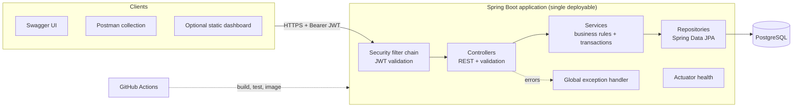
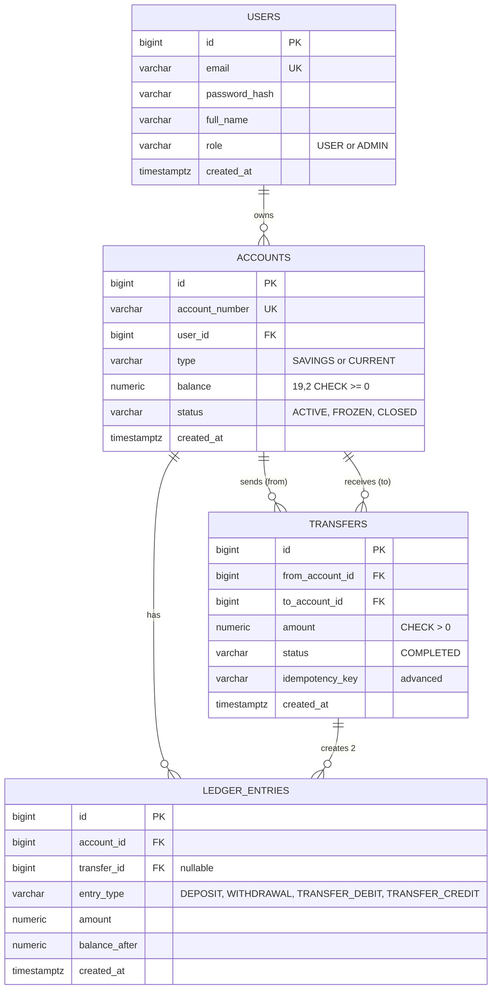
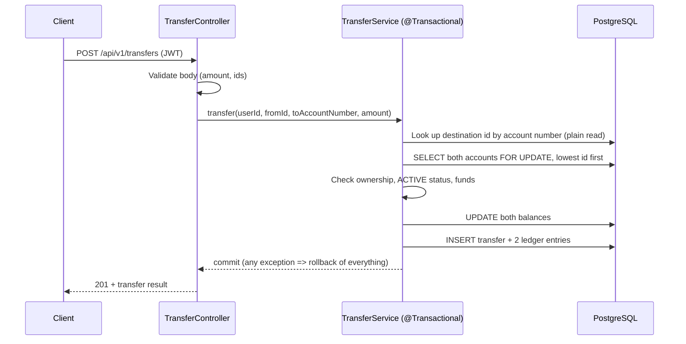
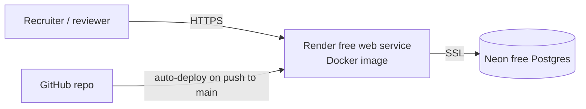

# Online Banking Simulation System: Requirements and Architecture

**Role in the set:** Project 1 of 5. Backend depth: transactions, concurrency, security
**Status:** Planned. Nothing in this file is verified yet. If you already have partial code, compare it with this file first (Milestone M0).
**Last researched:** 22 Oct 2026

> How to use this file: keep it in the repo as `docs/DESIGN.md`. Every requirement has an ID (like `BANK-FR-05`). Tests, README and resume claims must point back to these IDs. Tick a box only when you have run it and seen the result yourself.

---

## 0. Decisions already made (do not reopen without a reason)

| # | Decision | Why | Trade-off |
|---|---|---|---|
| D1 | Java 21, Spring Boot **3.5.x (latest patch)**, Maven, PostgreSQL 16 | Java 21 is a long-term-support release and Boot 3.x is still widely used. | Boot 3.5 stopped getting free patches on 30 Jun 2026; Boot 4.1 is current. Migration to 4.1 is an optional last milestone (M10) and becomes a good proof-of-work item. |
| D2 | JWT login with Spring Security | Appears in senior postings (Citi lists it) and is a common interview topic | More to learn than basic auth |
| D3 | Pessimistic row locking for transfers, locks taken in ascending account-id order | Money must never be lost or duplicated, and ordered locking prevents deadlock | Slower under heavy load than optimistic locking; fine for this scale |
| D4 | Flyway for database migrations | Shows schema changes are versioned and reproducible | One more tool |
| D5 | Testcontainers (real PostgreSQL) for integration tests | H2 behaves differently from PostgreSQL on locking and constraints | Needs Docker running locally |
| D6 | Swagger UI + Postman are the main "frontend"; a small static dashboard is optional (M9) | Employers evaluate the backend. A custom UI costs time and adds little proof. | Less visual for non-technical viewers |
| D7 | Fictional data only; currency INR; no real bank APIs | Safe and honest | None |

---

## 1. Problem statement

People need to hold money in accounts and move it safely. The risks are lost updates (two requests overwrite each other), half-completed transfers, and users reading or changing other people's accounts. This project is a **simulated** bank backend that solves those problems and can prove it with tests.

**Users**
- **Customer (USER):** registers, opens accounts, deposits, withdraws, transfers, views history.
- **Administrator (ADMIN):** lists accounts and freezes or unfreezes them.

**Scope**

| Level | Features |
|---|---|
| **MVP** | Register/login, accounts, deposit, withdraw, atomic transfer, transaction history with pagination, admin freeze, consistent errors, tests, Docker, CI, deployment |
| **Advanced (only after MVP is done and verified)** | Idempotency key on transfers, daily transfer limit, account statement export (CSV), audit log, optional static dashboard |
| **Out of scope** | Real payments, real KYC, notifications, microservices, Kafka, Kubernetes, mobile app |

---

## 2. Functional requirements and acceptance criteria

| ID | Requirement | Acceptance criteria |
|---|---|---|
| BANK-FR-01 | Register | Given a new email and a valid password, when I register, then I get 201 and the password is stored only as a BCrypt hash. A duplicate email returns 409. |
| BANK-FR-02 | Login | Given correct credentials, I get a JWT that expires in 15 minutes. Wrong credentials return 401 with no hint about which part was wrong. |
| BANK-FR-03 | Open account | A logged-in user can open SAVINGS or CURRENT accounts. Each gets a unique 12-digit fictional number and starts with balance 0.00. |
| BANK-FR-04 | List/view my accounts | I see only my own accounts. Asking for someone else's account returns 404 (not 403, so existence is not leaked). |
| BANK-FR-05 | Deposit | Amount must be at least 0.01 with at most 2 decimals. Balance increases by exactly that amount and a ledger row is written. |
| BANK-FR-06 | Withdraw | Fails with 422 `INSUFFICIENT_FUNDS` if balance would go below zero. Balance never becomes negative. |
| BANK-FR-07 | Transfer | Money moves between two ACTIVE accounts in **one** database transaction. If any step fails, neither balance changes. The destination is identified by its 12-digit account number, never by internal id. Cannot transfer to the same account. I must own the source account. An unknown destination number returns 404. |
| BANK-FR-08 | Transaction history | Paginated, newest first, filterable by type and date range. Only for my own accounts. |
| BANK-FR-09 | Freeze/unfreeze (ADMIN) | A FROZEN account rejects deposits, withdrawals and transfers with 409 `ACCOUNT_FROZEN`. Only ADMIN can change status; a USER gets 403. |
| BANK-FR-10 | Consistent errors | Every error uses one JSON shape (section 8) and never shows a stack trace. |
| BANK-FR-11 (adv.) | Idempotent transfer | Sending the same `Idempotency-Key` twice creates one transfer and returns the same result. |
| BANK-FR-12 (adv.) | Daily limit | Total outgoing transfers per account per day cannot exceed a configured limit. |

## 3. Non-functional requirements

| ID | Requirement | How to check |
|---|---|---|
| BANK-NFR-01 | **Correctness:** sum of ledger entries for an account always equals its balance | Integrity test (T-INT-01) |
| BANK-NFR-02 | **Concurrency safety:** parallel transfers never lose money or deadlock | Concurrency tests (T-CON-01, T-CON-02) |
| BANK-NFR-03 | **Security:** no secrets in Git; passwords hashed; every endpoint except register/login/health needs a valid JWT | Secret scan, security tests |
| BANK-NFR-04 | **Reproducibility:** a stranger can run it with `docker compose up` | Clean-clone test |
| BANK-NFR-05 | **Observability:** `/actuator/health` works; logs never contain passwords or tokens | Manual check, log review |
| BANK-NFR-06 | **Maintainability:** CI runs build and tests on every push | Green workflow run |

---

## 4. Technology stack

| Area | Choice | Notes |
|---|---|---|
| Language/runtime | Java 21 | LTS version |
| Framework | Spring Boot 3.5.x | Use the latest 3.5 patch from start.spring.io and pin it in `pom.xml` |
| Web | Spring Web (REST), Bean Validation | |
| Data | Spring Data JPA (Hibernate), PostgreSQL 16, Flyway | Schema comes from migrations, not `ddl-auto` |
| Security | Spring Security 6, BCrypt, JWT via Spring's OAuth2 Resource Server (Nimbus) | Official, fewer hand-written crypto pieces. `jjwt` is the common alternative if you prefer a custom filter. |
| API docs | springdoc-openapi 2.x (Boot 3 line) | Check its compatibility table when you pick the version |
| Tests | JUnit 5, Mockito, Spring Boot Test, MockMvc, Testcontainers, JaCoCo | |
| Build/CI | Maven, GitHub Actions | Free for public repos |
| Container | Docker (multi-stage), Docker Compose | |
| Hosting | See section 12 | |

---

## 5. System architecture



**Layer rule:** controllers never touch repositories; services hold all business rules and `@Transactional`; repositories only talk to the database. This is a very common interview question.

### Package structure (feature-first)

```
com.banksim
├── BankSimApplication.java
├── config/            SecurityConfig, OpenApiConfig, JwtProperties
├── common/            ApiError, GlobalExceptionHandler, exceptions
├── auth/              AuthController, AuthService, dto/
├── user/              User, UserRepository, Role
├── account/           Account, AccountController, AccountService, AccountRepository, dto/
├── transaction/       LedgerEntry, TransactionController, TransactionService, repository
└── transfer/          Transfer, TransferController, TransferService, TransferRepository, dto/
src/main/resources
├── db/migration/      V1__create_users.sql, V2__create_accounts.sql, ...
└── application.yml, application-prod.yml
src/test/java          mirrors main; integration tests extend an AbstractIntegrationTest (Testcontainers)
```

---

## 6. Database design



**Rules and indexes**
- Money is `NUMERIC(19,2)` in the database and `BigDecimal` in Java. **Never `double`.**
- `CHECK (balance >= 0)` on accounts is the last safety net even if code has a bug.
- `CHECK (from_account_id <> to_account_id)` on transfers.
- Indexes: `accounts(user_id)`, `ledger_entries(account_id, created_at DESC)`, unique `(from_account_id, idempotency_key)` for the advanced feature.
- One migration file per change. Never edit a migration that has already run; add a new one.
- Seed data (a demo user and an admin) goes in a separate `dev` profile migration or startup runner, never with real-looking passwords committed in plain text.

---

## 7. How a transfer works (the core of the project)



Why ordered locks: if A→B and B→A run at the same time and each locks its own source first, they can wait on each other forever (a deadlock). Always locking the lower id first removes that possibility.

---

## 8. API specification (base path `/api/v1`)

| Method | Path | Auth | Purpose |
|---|---|---|---|
| POST | `/auth/register` | none | Create user |
| POST | `/auth/login` | none | Get JWT |
| GET / POST | `/accounts` | USER | List mine / open account |
| GET | `/accounts/{id}` | USER (owner) | One account |
| POST | `/accounts/{id}/deposit` | USER (owner) | Deposit |
| POST | `/accounts/{id}/withdraw` | USER (owner) | Withdraw |
| POST | `/transfers` | USER (owner of source) | Transfer |
| GET | `/accounts/{id}/transactions?page=0&size=20&type=&from=&to=` | USER (owner) | History |
| GET | `/admin/accounts` | ADMIN | List all |
| PATCH | `/admin/accounts/{id}/status` | ADMIN | Freeze/unfreeze |
| GET | `/actuator/health` | none | Health |

**Examples**

`POST /auth/register`
```json
{ "fullName": "Demo User", "email": "demo@example.com", "password": "Str0ng#Pass1" }
```
`201`
```json
{ "id": 1, "email": "demo@example.com", "role": "USER" }
```

`POST /auth/login` → `200`
```json
{ "accessToken": "<jwt>", "tokenType": "Bearer", "expiresInSeconds": 900 }
```

`POST /transfers`
```json
{ "fromAccountId": 1, "toAccountNumber": "100000000002", "amount": "250.00", "description": "Rent share" }
```
`201`
```json
{ "transferId": 17, "fromAccountId": 1, "toAccountNumber": "100000000002", "amount": "250.00",
  "status": "COMPLETED", "createdAt": "2026-11-01T09:30:00Z" }
```

**One error shape for everything** (Spring's built-in `ProblemDetail` with extra fields)
```json
{ "type": "about:blank", "title": "Insufficient funds", "status": 422,
  "detail": "Balance 100.00 is lower than requested 250.00",
  "code": "INSUFFICIENT_FUNDS", "timestamp": "2026-11-01T09:30:00Z", "path": "/api/v1/transfers" }
```

| Code | HTTP | When |
|---|---|---|
| VALIDATION_ERROR | 400 | Bad body or amount (list field errors) |
| UNAUTHORIZED | 401 | Missing, invalid or expired token; bad login |
| FORBIDDEN | 403 | Wrong role (for example USER calling admin) |
| ACCOUNT_NOT_FOUND | 404 | Missing **or not yours** |
| DUPLICATE_EMAIL / ACCOUNT_FROZEN | 409 | Conflict |
| INSUFFICIENT_FUNDS | 422 | Not enough balance |
| INTERNAL_ERROR | 500 | Unexpected; generic message, details only in logs |

---

## 9. Security design

- Passwords: BCrypt via `PasswordEncoder`. Minimum rules enforced by validation.
- Token: JWT signed with a secret read from the environment variable `JWT_SECRET` (at least 32 random bytes). Expires in 15 minutes. Refresh tokens are out of scope.
- Roles stored on the user and put in a token claim; `@PreAuthorize("hasRole('ADMIN')")` on admin endpoints.
- **Ownership check inside the service** for every account operation (the role alone is not enough: a USER must not touch another USER's account).
- CORS: not needed while everything is served from the same origin.
- Stateless sessions, CSRF disabled **because** there are no cookies. You must be able to explain that sentence in an interview.
- Never log passwords, tokens or the secret. Never commit `.env`; commit `.env.example` only.
- Turn on GitHub secret scanning/push protection and Dependabot for the repo (check current availability in repo settings).

---

## 10. Testing strategy (each test ID maps to a requirement)

| ID | Type | Scenario | Covers |
|---|---|---|---|
| T-UNIT-01 | Unit (Mockito) | Withdraw with insufficient funds throws `InsufficientFundsException` | FR-06 |
| T-UNIT-02 | Unit | Transfer to the same account is rejected | FR-07 |
| T-UNIT-03 | Unit | Transfer from an account the user does not own is rejected | FR-07 |
| T-UNIT-04 | Unit | Amount with 3 decimals or zero is rejected | FR-05 |
| T-API-01 | MockMvc | Register OK, duplicate email 409 | FR-01 |
| T-API-02 | MockMvc | Login wrong password 401 | FR-02 |
| T-API-03 | MockMvc | No token on `/accounts` gives 401 | NFR-03 |
| T-API-04 | MockMvc | USER calling `/admin/accounts` gives 403 | FR-09 |
| T-API-05 | MockMvc | USER reading another user's account gives 404 | FR-04 |
| T-API-06 | MockMvc | Invalid body returns the standard error JSON | FR-10 |
| T-INT-01 | Integration (Testcontainers) | After a series of operations, balance equals sum of ledger entries | NFR-01 |
| T-INT-02 | Integration | Transfer failing midway leaves both balances unchanged | FR-07 |
| T-INT-03 | Integration | Frozen account rejects all money operations | FR-09 |
| T-CON-01 | Concurrency | 50 parallel transfers A→B; final balances and total money are exactly right | NFR-02 |
| T-CON-02 | Concurrency | Parallel A→B and B→A transfers finish without deadlock | NFR-02 |
| T-ADV-01 | Integration | Same idempotency key twice creates one transfer | FR-11 |

Rules: run with `./mvnw verify`; generate the JaCoCo report; **write down the real coverage number only after you see it**; do not chase a percentage.

---

## 11. Optional frontend (Milestone M9, only after M8)

Plain HTML + CSS + JavaScript in `src/main/resources/static/`, served by the same Spring Boot app (no separate hosting, no CORS, no build step).

| Page | Shows | Calls |
|---|---|---|
| `login.html` / `register.html` | Forms | `/auth/*` |
| `dashboard.html` | My accounts and balances, "open account" | `GET/POST /accounts` |
| `account.html?id=` | Transaction table with pagination, deposit/withdraw forms | `/accounts/{id}/...` |
| `transfer.html` | Source account, destination account number, amount | `POST /transfers` |
| `admin.html` (ADMIN) | All accounts, freeze button | `/admin/...` |

Keep the token in memory or `sessionStorage` and say in the README that HttpOnly cookies would be safer. Show server text with `textContent`, never `innerHTML`.

---

## 12. DevOps and deployment

### 12.1 Environment variables

| Name | Example | Secret? |
|---|---|---|
| `SPRING_PROFILES_ACTIVE` | `prod` | no |
| `DB_URL` | `jdbc:postgresql://host:5432/bank?sslmode=require` | no |
| `DB_USERNAME` / `DB_PASSWORD` | from the database provider | **yes** |
| `JWT_SECRET` | 32+ random bytes | **yes** |
| `JAVA_TOOL_OPTIONS` | `-XX:MaxRAMPercentage=70 -XX:+UseSerialGC` | no |

Commit `.env.example` with fake values. Real values live only in the host's dashboard.

### 12.2 Dockerfile outline

Two stages: build with a Maven + JDK 21 image, then run with a JRE 21 image as a **non-root user**, exposing 8080. Add a `HEALTHCHECK` on `/actuator/health`.

### 12.3 docker-compose outline

Two services: `db` (postgres:16 with a volume and a health check) and `app` (built from the Dockerfile, `depends_on` db healthy). `docker compose up` must work from a clean clone.

### 12.4 CI (GitHub Actions) outline

On push and pull request: checkout, set up Temurin JDK 21 with Maven cache, run `./mvnw -B verify` (Testcontainers works on GitHub's Linux runners), upload the JaCoCo report as an artifact, build the Docker image (no push needed at first). Add the status badge to the README.

### 12.5 Deployment architecture (checked 22 Oct 2026; prices change, re-check before you commit)



| Option | Findings | Verdict |
|---|---|---|
| **Render free web service + Neon free Postgres** | Render's free web service sleeps after 15 min idle and takes about a minute to wake; free Render Postgres **expires after 30 days**, so use Neon instead. Neon's free plan sleeps compute after 5 min idle and has a small storage cap (sources disagree between 0.5 GB and 1 GB; check their plans page). | **Recommended: costs nothing** |
| Railway | New accounts get a one-time $5 trial credit for 30 days, then a Free plan with $1 per month of credit, or Hobby at $5 per month | Not free for an always-on Java app. My estimate from their per-GB pricing, not a measured result. |
| Docker Compose only | Free, fully reproducible | Always keep as the fallback |

**Honest consequences:** the first request after idle can take a minute or more. Put that in the README ("demo may need about 60 seconds to wake") so a reviewer is not surprised. Whether the app fits in the free instance's memory is **unverified**; the JVM flags above are the starting point, and you must test it.

### 12.6 Health and logging
`/actuator/health` exposed publicly, other actuator endpoints off. Log one line per request (method, path, status, duration) without bodies.

---

## 13. Proof-of-work checklist (tick only after you personally verified)

| ✔ | Artifact | Location | How anyone verifies | Done when |
|---|---|---|---|---|
| ☐ | Public repo with real commit history | GitHub | Open the commit list | Commits are small and meaningful |
| ☐ | README | `README.md` | Follow it on a clean machine | Setup works in under 10 minutes |
| ☐ | ER diagram + migrations | `docs/`, `db/migration` | `docker compose up` creates the schema | Matches section 6 |
| ☐ | OpenAPI/Swagger | `/swagger-ui.html` | Open it | Every endpoint has examples |
| ☐ | Postman collection with failure cases | `postman/` | Import and run | Success and error cases both pass |
| ☐ | Unit + integration + concurrency tests | `src/test` | `./mvnw verify` | All T-IDs in section 10 pass |
| ☐ | Coverage report | CI artifact | Download from a workflow run | Real number recorded, not invented |
| ☐ | CI green | Actions tab | Click the badge | Last run on `main` is green |
| ☐ | Docker run | `docker-compose.yml` | `docker compose up` | Works from a clean clone |
| ☐ | Deployed demo (or reproducible steps) | README link | Open the URL | `/actuator/health` returns UP |
| ☐ | Design document | `docs/DESIGN.md` | Read it | Explains D1 to D7 and trade-offs |
| ☐ | Troubleshooting log | `docs/TROUBLESHOOTING.md` | Read it | Only real problems you solved |
| ☐ | Requirement traceability | `docs/TRACEABILITY.md` | Table | Each FR → code → test → demo step |
| ☐ | Demo video (2 to 3 min) | README link | Watch it | Shows login, transfer, failure case, test run |

---

## 14. Milestones (in order; effort is a rough guess in focused sessions of about 2 to 3 hours)

| M | Goal | Acceptance | Sessions |
|---|---|---|---|
| M0 | Audit existing code against this file | Written list: what exists, what runs, what is missing | 1 |
| M1 | Foundation: Flyway schema, entities, health, CI skeleton | `mvn verify` green in CI | 2 |
| M2 | Auth: register, login, JWT, roles | T-API-01 to 04 pass | 3 |
| M3 | Accounts, deposit, withdraw, validation, error handler | FR-03 to 06, FR-10 and related tests pass | 3 |
| M4 | Atomic transfer + ledger | FR-07, T-UNIT-02/03, T-INT-02 pass | 3 |
| M5 | Concurrency and integrity tests | T-CON-01/02, T-INT-01 pass | 2 |
| M6 | History + admin freeze | FR-08, FR-09 pass | 2 |
| M7 | Docs, Postman, Docker, CI complete | Section 13 rows through "Docker run" ticked | 3 |
| M8 | Deploy, demo video, design doc, troubleshooting log | Live URL or reproducible steps verified | 2 |
| M9 | Optional dashboard or advanced features (FR-11, FR-12) | Only if M8 is done | 3 |
| M10 | Optional: migrate to Spring Boot 4.1 with a migration log | Tests green on 4.1 | 3 |

---

## 15. Resume, GitHub and LinkedIn packaging

**Repo name:** `banking-system-spring-boot`
**Description:** "Simulated banking REST API: JWT security, atomic and concurrency-safe transfers, PostgreSQL, Docker, CI."
**Topics:** `java`, `spring-boot`, `spring-security`, `jwt`, `postgresql`, `jpa`, `flyway`, `docker`, `junit`, `testcontainers`

**Resume bullet templates: use a bullet only after its proof exists; fill every blank from real results**
- "Built a REST API for a simulated banking system using Java 21, Spring Boot, Spring Security (JWT) and PostgreSQL." *(needs: running app + repo)*
- "Implemented transfers inside a single database transaction with ordered row locks and wrote a concurrency test with ___ parallel requests to confirm balances stayed correct." *(needs: T-CON-01 passing, number from the real test)*
- "Wrote ___ unit and integration tests (JUnit, Mockito, Testcontainers); CI runs them on every push with GitHub Actions." *(needs: real count, green CI)*
- "Containerised the app with Docker and deployed it to ___." *(needs: working URL)*

**LinkedIn:** add the repo and live link under Featured, and one post describing the transfer-locking decision in your own words.

---

## 16. Interview questions this project must let you answer

1. Why `BigDecimal` and not `double`?
2. What does `@Transactional` do, and when does it roll back?
3. How do you stop two transfers from corrupting a balance? Why lock in id order?
4. Pessimistic vs optimistic locking: which and why?
5. Why return 404 for another user's account instead of 403?
6. How does JWT validation work, and why is CSRF disabled here?
7. Why Flyway instead of `ddl-auto=update`?
8. Why Testcontainers instead of H2?
9. What is idempotency and why does it matter for payments?
10. What would you change to scale this to many users? (Be honest about limits.)

---

## 17. Known limitations (state these openly in the README)

- Simulated only; no real money, no real compliance.
- Single instance; no caching or messaging.
- Free hosting sleeps when idle.
- Refresh tokens and rate limiting are not implemented.

## 18. If you already have partial code (do first in M0)

Compare your code with this file: Boot version, which tables exist, whether auth exists, whether transfers are transactional, whether any secret is in Git history. If a secret is in history, rotate it first.

## Core Java evidence (job postings ask for this, so make it visible)

Employers such as Ford list collections, exceptions, concurrency and streams. This project should show:
- **Exceptions:** a custom exception hierarchy (`InsufficientFundsException`, `AccountFrozenException`) mapped to HTTP codes by the global handler.
- **Concurrency:** T-CON-01/02 use `ExecutorService` and `CountDownLatch` to fire parallel transfers. You must be able to explain what each does.
- **Collections and streams:** map ledger entries to response DTOs with streams, and group them by type for a small summary in a unit test.
- **OOP:** an `Account` rule such as "can this account send money?" lives inside the entity or service, not in the controller.

## 19. Plain-English glossary

- **Transaction:** a group of database changes that either all happen or none happen.
- **Lock (`FOR UPDATE`):** makes other requests wait until you finish with a row.
- **Deadlock:** two requests each waiting for a row the other holds.
- **Migration:** a numbered SQL file that changes the database structure in a repeatable way.
- **JWT:** a signed token the client sends with each request to prove who it is.
- **Idempotency:** repeating the same request has the same effect as sending it once.
- **Ledger:** an append-only list of money movements.

## 20. Sources checked (22 Oct 2026)
Spring Boot support dates: https://eosl.date/eol/product/spring-boot/ · Render free tier: https://render.com/docs/free · Railway plans: https://docs.railway.com/pricing/plans · Neon plans: https://neon.com/docs/introduction/plans
